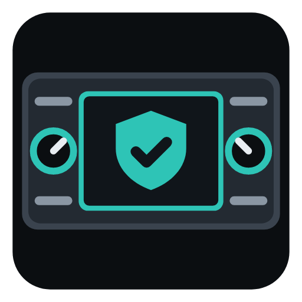
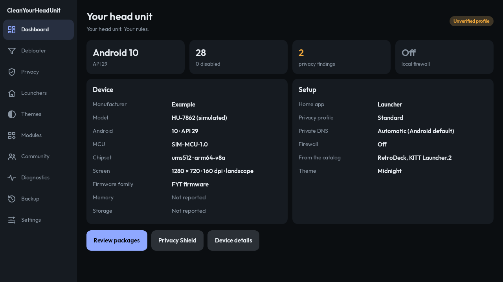
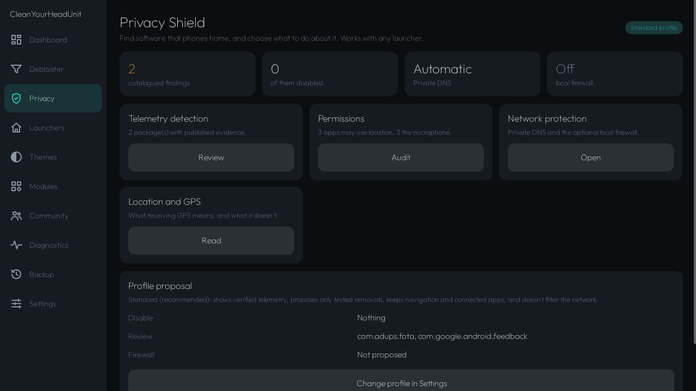
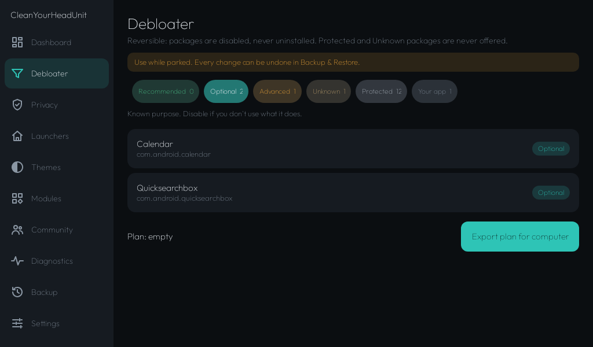
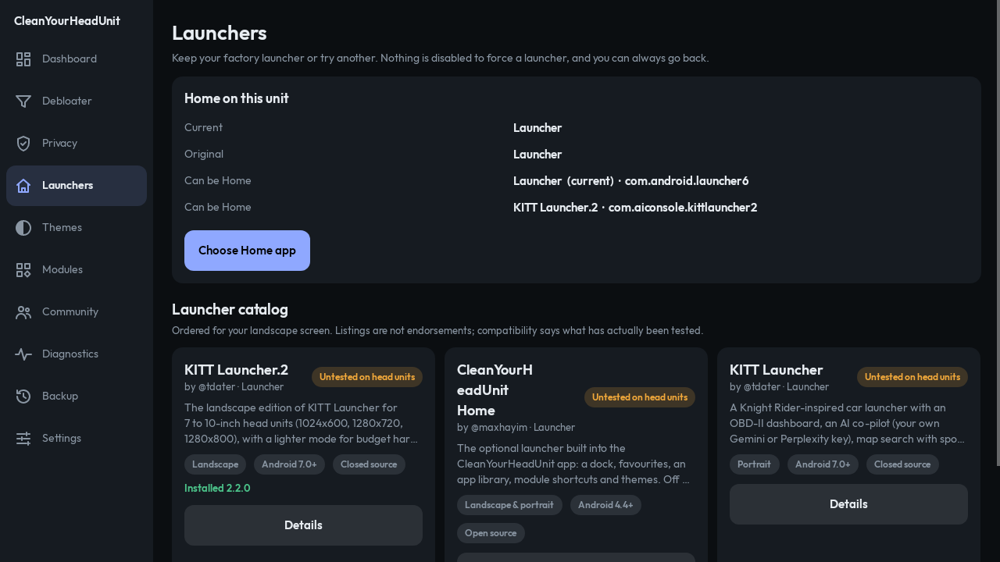
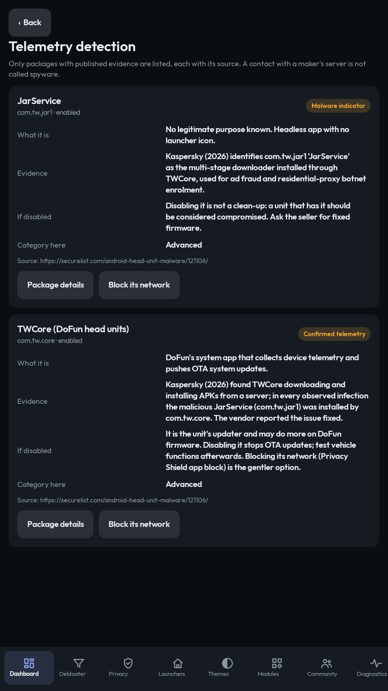
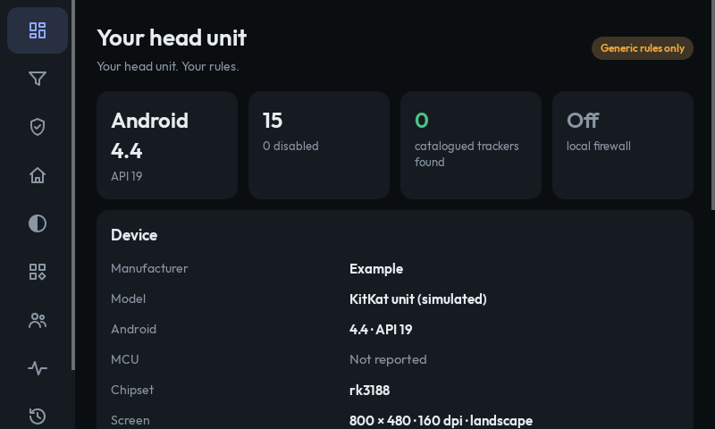

  

  <strong>Your Head Unit. Your Rules.</strong> 
  Debloat • Protect • Optimize • Customize

  
  
  
  

<h1>CleanYourHeadUnit</h1>

CleanYourHeadUnit is an open-source toolkit for aftermarket Android car head units: the FYT, MTCD/MTCE, DoFun, "Tesla-style" and no-name units sold for most cars. It finds the preinstalled software you don't need, shows which apps are known to phone home, and lets you change all of it back. You can try another launcher without losing the factory one. Nothing needs root.

It comes in two parts that share the same rules:

<ul>
  <li><strong>The app</strong> (Android 4.4 and newer) runs on the head unit. It covers the dashboard, package review, Privacy Shield with an optional local firewall, launchers, themes, modules, the Community Hub, diagnostics and backup.</li>
  <li><strong><code>cyhu</code></strong> (Python, no dependencies) runs on a computer connected over ADB. It does the actual disabling, records the state before every change, verifies the result and restores it.</li>
</ul>

CleanYourHeadUnit is derived from <a href="https://github.com/Gathin23/cleanyourtv">CleanYourTV</a> by <a href="https://github.com/Gathin23">@Gathin23</a>. It keeps the same approach (reversible, non-root, explain everything) and adapts it to cars. CleanYourTV is not affiliated with this project and has not endorsed it. See <a href="CREDITS.md">CREDITS.md</a> and <a href="docs/reuse-audit.md">docs/reuse-audit.md</a>.

> [!IMPORTANT]
> **Nothing here has been tested on a real head unit yet.** All the code below has passing tests against *simulated* units (see [docs/test-report.md](docs/test-report.md)), but no head unit has been through the [hardware checklist](docs/hardware-checklist.md). That's why no device profile is "tested" and the **Recommended** category is empty everywhere. Use it while parked, and keep the [restore steps](RESTORE.md) at hand.

<h2>Screenshots</h2>

<em>These are renders of the app's own code by its test suite (Robolectric), using simulated head units from <code>tests/fixtures</code>. They are not photos of a real unit. Package names marked <code>com.example.*</code> and the model names are invented.</em>

<table>
  <tr>
    <td> Dashboard: 1280×720 landscape</td>
    <td> Privacy Shield</td>
  </tr>
  <tr>
    <td> Debloater: 1024×600</td>
    <td> Launchers and the launcher catalog</td>
  </tr>
  <tr>
    <td> Telemetry detection: 1080×1920 portrait</td>
    <td> 800×480, Android 4.4 (icon-only rail)</td>
  </tr>
</table>

More in <a href="docs/screenshots">docs/screenshots</a>.

<h2>Features</h2>

<ul>
  <li><strong>Reversible debloating.</strong> Packages are disabled for user 0 (<code>pm disable-user</code>), never uninstalled. Each package shows its purpose, the proposed action, a confidence level, its risks and how to restore it.</li>
  <li><strong>Five categories.</strong> Recommended, Optional, Advanced, Protected and Unknown. <strong>Protected</strong> and <strong>Unknown</strong> packages are never offered. Protected covers Android core plus everything vehicle-related: MCU, CAN bus, climate, cameras, parking sensors, steering-wheel controls, radio, amplifier, audio routing, Bluetooth calling, microphone, vehicle settings, updaters, and whichever app is Home.</li>
  <li><strong>Device profiles</strong> for FYT, MTCD/MTCE, DoFun/TW, ALPS/YT9216 and Sergey Kozlov firmware. A profile matches on what the unit runs, never on a brand name. Profiles can only protect more or explain more. None can make an unknown package removable.</li>
  <li><strong>Backup and restore.</strong> The unit is recorded as first seen. Every change is logged before and after, and restore works per package, for the launcher, for Private DNS, or for everything. Running it twice is safe. Settings you changed yourself afterwards are left alone. There's also an emergency procedure using plain <code>adb</code>.</li>
  <li><strong>Privacy Shield:</strong>
    <ul>
      <li><em>Telemetry detection</em> from a catalogue that lists only packages with published evidence, each with its source (Adups FOTA, Redstone, DoFun TWCore and its "JarService" downloader).</li>
      <li>A <em>permission audit</em>, and <em>Private DNS</em> (Android 9+) with four filtering providers.</li>
      <li>Standard, Strict and Custom <em>profiles</em>.</li>
      <li>An optional <em>local firewall</em> (Android 4.4+ for DNS filtering, 5.0+ for blocking apps). It uses Android's own VPN permission, shows a notification while it runs, and never starts by itself.</li>
    </ul>
  </li>
  <li><strong>Launchers.</strong> Keep the factory launcher or switch. The factory launcher is never disabled to force a switch, and the launcher you started with is remembered so you can go back. The catalog includes <a href="https://github.com/tdater/KITT-Launcher-releases">KITT Launcher</a> (portrait) and <a href="https://github.com/tdater/KITT-Launcher.2-releases">KITT Launcher.2</a> (landscape) by <a href="https://github.com/tdater">@tdater</a>.</li>
  <li><strong>CleanYourHeadUnit Home</strong>, an optional launcher with a dock, favourites, an app library and themes. It's off until you turn it on.</li>
  <li><strong>Themes</strong> are plain JSON (colours and layout, never code), validated on import. Three are built in: Midnight, Amber Dash and Daylight.</li>
  <li><strong>Modules and the Community Hub</strong> list independent projects that suit head units, with credit to each developer's GitHub. Installs come only from the developer's own GitHub release, and are checked against the release checksum and the developer's signing certificate before Android's installer asks you.</li>
  <li><strong>Companion phone app</strong> (<a href="COMPANION.md">COMPANION.md</a>): does the computer tool's job from an Android phone, over USB (OTG) or Wi-Fi. It's also a <strong>bridge</strong>: plugged into a unit over USB, it switches the unit's ADB to Wi-Fi, so units with no Wireless debugging (many "Android 13" units really run 8.1 or 9) can then be reached without a cable. It shows the real Android version when the unit's settings claim a newer one.</li>
  <li><strong>Diagnostics</strong> with a sanitised export: serial numbers, MAC addresses, account names and network names are removed. Nothing is ever uploaded.</li>
  <li>No account, no analytics, no ads, no tracking.</li>
</ul>

<h2>Requirements</h2>

<ul>
  <li><strong>App:</strong> Android 4.4 (API 19) or newer, any screen from 800×480 to 1920×720, in landscape or portrait. The local firewall's App block mode needs Android 5.0, and Private DNS needs Android 9.</li>
  <li><strong>Companion phone app:</strong> an Android 7.0+ phone, and for USB an OTG cable or adapter. The head unit's USB port must be able to act as a device.</li>
  <li><strong>Computer tool:</strong> Python 3.9+ and <a href="https://developer.android.com/tools/releases/platform-tools">Android platform-tools</a> (<code>adb</code>). It runs on Windows, macOS and Linux.</li>
  <li>The head unit's Developer options with USB debugging (or ADB over Wi-Fi) turned on. Where to find it varies by firmware: see <a href="INSTALL.md">INSTALL.md</a>.</li>
</ul>

<h2>Installation and Setup</h2>

The short version (details and per-firmware notes in <a href="INSTALL.md">INSTALL.md</a>):

<pre>
git clone https://github.com/maxhayim/CleanYourHeadUnit
cd CleanYourHeadUnit
adb connect 192.0.2.10:5555        # or plug in USB; use your unit's address
python3 tools/cyhu.py status       # read-only: identifies the unit
python3 tools/cyhu.py backup       # records the unit as it is now
</pre>

For the app, build it (<code>./gradlew :app:assembleDebug</code>) and install it with <code>adb install</code>. The phone companion has a pre-release APK on the <a href="https://github.com/maxhayim/CleanYourHeadUnit/releases">Releases</a> page (see <a href="COMPANION.md">COMPANION.md</a>), or build it with <code>./gradlew :companion:assembleDebug</code>. The head-unit app and the computer tool have no published release yet.

<h2>Usage</h2>

Everything that changes the unit shows what it will do and asks first. Run these while parked.

<pre>
python3 tools/cyhu.py inventory                      # every package and its category
python3 tools/cyhu.py debloat plan --category optional
python3 tools/cyhu.py debloat apply --packages com.android.egg,com.android.printspooler
python3 tools/cyhu.py privacy audit                  # telemetry findings + permissions
python3 tools/cyhu.py privacy dns adguard            # Private DNS (Android 9+)
python3 tools/cyhu.py launcher list
python3 tools/cyhu.py restore --all                  # put everything back
python3 tools/cyhu.py restore --script               # plain adb commands, for emergencies
python3 tools/cyhu.py diagnostics --out report.json  # sanitised
</pre>

You can try it without a head unit: every command accepts <code>--demo tests/fixtures/fyt-android10-1280x720.json</code> (a simulated FYT unit). Part of a real plan from that simulated unit:

<pre>
com.adups.fota  [advanced]
  purpose    Over-the-air firmware updates on many low-cost MediaTek devices.
  action     disable for user 0 (reversible; nothing is uninstalled)
  confidence low (needs your review)
  risk       It is also the firmware updater: with it disabled, the unit gets no OTA updates
             from the seller. Which version a head unit carries is not known until it is checked.
  restore    cyhu restore --package com.adups.fota   (or: adb shell pm enable --user 0 com.adups.fota)
  finding    confirmed_telemetry
</pre>

On the head unit itself, the app can't disable system apps without ADB (Android doesn't allow it). Instead, it opens each app's page in Android Settings, where some firmware offers a Disable button. It also exports your plan as a <code>cyhu</code> command plus plain <code>adb</code> lines, with the matching undo lines.

<h2>How It Works</h2>

<ul>
  <li><code>data/</code> holds the rules all three parts use (computer tool, head-unit app, phone companion): protected packages, the telemetry catalogue, device profiles, DNS providers and the module/launcher catalog. Both apps ship a copy of it, and share one Java classifier (<code>shared/java</code>). <code>tests/vectors/classify.json</code> is run by both the Python and the Java tests, so the two can't drift apart.</li>
  <li>Each package is classified in a fixed order: Android core first (this can never be overridden), then whichever apps can be Home on this unit, then the matched profile's protected list, then the telemetry catalogue, then vehicle namespaces (<code>com.syu.*</code>, <code>*.microntek.*</code>, <code>com.tw.*</code>) and vehicle words in the package name (<code>mcu</code>, <code>canbus</code>, <code>door</code>, <code>avm</code>, <code>radio</code>, <code>bt</code>…), then profile entries, so a profile can never make a vehicle app removable. Anything left over is <strong>Unknown</strong>.</li>
  <li>"Recommended" is only possible from a profile marked <em>tested</em> on real hardware. Today none is, so those entries show as Optional.</li>
  <li>The only commands used on the unit are <code>pm disable-user --user 0</code>, <code>pm enable --user 0</code>, <code>cmd package set-home-activity</code> and the <code>private_dns_*</code> settings. Nothing touches the MCU, the CAN bus, ECUs or firmware.</li>
</ul>

<h2>Known Limitations</h2>

<ul>
  <li>Not yet tested on any real head unit (see the note above and <a href="COMPATIBILITY.md">COMPATIBILITY.md</a>).</li>
  <li>Some firmware blocks <code>pm disable-user</code> for certain packages, or restores them on reboot. <code>cyhu</code> verifies every change and reports these.</li>
  <li>An empty telemetry list means none of the <em>catalogued</em> packages is installed. It doesn't mean nothing on the unit talks to the internet. Per-app network activity can't be observed over ADB without root.</li>
  <li>DNS filtering doesn't stop apps that use their own DNS or fixed IP addresses. The local firewall counts what it blocks; it can't see everything an app sends. Android allows only one VPN at a time.</li>
  <li>The phone companion doesn't do Android 11+ wireless-debugging pairing yet, and it needs a head unit whose USB port can act as a device for the bridge.</li>
  <li>Sergey Kozlov firmware can't be recognised automatically, so you declare it (<code>--firmware sergey-kozlov</code>, or the switch in the app's Settings).</li>
  <li>Many cars have a separate telematics module outside Android. CleanYourHeadUnit can't see or control it.</li>
</ul>

<h2>Tested On</h2>

<strong>One real unit, read-only so far:</strong> a Fortdows unit for the 2012–2014 Toyota Camry (SC7731E / UIS8141E, 2 GB, 1280×800, FYT software). Its Settings say Android 13, but it runs 8.1 (API 27). The head-unit app installed and ran, recognised the FYT software, sorted 166 packages (65 Protected, 90 Unknown) and fitted the screen. Nothing was disabled, and the computer tool and the phone companion couldn't connect, because the unit's USB port only works as a host (it offers Android Auto to a phone). That first run found three bugs, fixed in the next commit: the dashboard showed the claimed Android version, the FYT profile name listed other chips, and launchers that share a name couldn't be told apart.

The test suite runs against four simulated units (FYT Android 10 at 1280×720, ALPS Android 8 at 1024×600, DoFun Android 12 in portrait at 1080×1920, and Android 4.4 at 800×480), plus 1920×720. To report a real unit, use the <a href="https://github.com/maxhayim/CleanYourHeadUnit/issues/new/choose">compatibility report</a> template.

<h2>License</h2>

MIT. See <a href="LICENSE">LICENSE</a>. It includes CleanYourTV's MIT copyright notice. The app's typeface, Outfit, is under the SIL Open Font License 1.1 (<a href="app/FONT-LICENSE-OFL.txt">app/FONT-LICENSE-OFL.txt</a>). Third-party launchers and modules keep their own licences and are never redistributed here.

<h2>Contributing</h2>

The most useful contributions are <strong>device profiles and compatibility reports from real units</strong>. Launchers, modules and themes are welcome too. See <a href="CONTRIBUTING.md">CONTRIBUTING.md</a>, <a href="COMMUNITY.md">COMMUNITY.md</a> and the <a href="https://github.com/maxhayim/CleanYourHeadUnit/issues/new/choose">issue templates</a>. Please read <a href="SAFETY.md">SAFETY.md</a> first.

<h2>Recommended Apps</h2>

Independent apps that suit a head unit. Each is its own project, installed and updated on its own. They're also at the top of the app's Community Hub. None has been tested on a car head unit yet.

<table>
  <tr><th>App</th><th>Developer</th><th>Why</th><th>Get it</th></tr>
  <tr><td><a href="https://github.com/maxhayim/RetroDeck">RetroDeck</a></td><td><a href="https://github.com/maxhayim">@maxhayim</a></td><td>Turns the screen into a classic car stereo, with every hardware and steering-wheel key mappable.</td><td>Download and install in the app (signature-checked), or <a href="https://github.com/maxhayim/RetroDeck/releases/latest">GitHub releases</a></td></tr>
  <tr><td><a href="https://github.com/maxhayim/webmote">Webmote</a></td><td><a href="https://github.com/maxhayim">@maxhayim</a></td><td>Control the unit from your phone's browser. Built for Android TV today; automotive support is planned.</td><td><a href="https://github.com/maxhayim/webmote/releases/latest">GitHub releases</a> (no install offered for head units yet)</td></tr>
  <tr><td><a href="https://localsend.org">LocalSend</a></td><td><a href="https://github.com/localsend">@localsend</a></td><td>Send music, maps and APKs from a phone or computer to the head unit over Wi-Fi: no cable, account or internet, and transfers are encrypted. Needs Android 7.0+ (1.17.0 for Android 5 and 6).</td><td><a href="https://play.google.com/store/apps/details?id=org.localsend.localsend_app">Google Play</a>, <a href="https://f-droid.org/packages/org.localsend.localsend_app">F-Droid</a>, or <a href="https://github.com/localsend/localsend/releases/latest">GitHub releases</a> (pick the APK for the unit's processor)</td></tr>
</table>

<h2>Related Projects</h2>

<ul>
  <li><a href="https://github.com/Gathin23/cleanyourtv">CleanYourTV</a> by <a href="https://github.com/Gathin23">@Gathin23</a>: the same idea for Android TV, and where this started.</li>
  <li><a href="https://github.com/maxhayim/RetroDeck">RetroDeck</a> by <a href="https://github.com/maxhayim">@maxhayim</a>: a retro car-stereo app with interchangeable skins (featured module).</li>
  <li><a href="https://github.com/maxhayim/webmote">Webmote</a> by <a href="https://github.com/maxhayim">@maxhayim</a>: a browser remote for Android TV. Automotive support is planned.</li>
  <li><a href="https://github.com/tdater/KITT-Launcher-releases">KITT Launcher</a> and <a href="https://github.com/tdater/KITT-Launcher.2-releases">KITT Launcher.2</a> by <a href="https://github.com/tdater">@tdater</a>.</li>
</ul>

<h2>Acknowledgments</h2>

<ul>
  <li><a href="https://github.com/Gathin23">@Gathin23</a> for CleanYourTV, its protected-package rules and its privacy catalogue approach.</li>
  <li><a href="https://github.com/tdater">@tdater</a> for KITT Launcher and KITT Launcher.2.</li>
  <li><a href="https://boosty.to/teslafw">Sergey Kozlov</a> for custom firmware for Tesla-style head units (official page on Boosty; no GitHub username could be verified).</li>
  <li>The researchers whose published work the telemetry catalogue cites: Kryptowire, Malwarebytes and Kaspersky.</li>
  <li><a href="https://github.com/PimpinPumpkin/fyt7862-mods">@PimpinPumpkin</a> and the XDA head-unit community, whose public notes the FYT and MTC profiles cite.</li>
</ul>

Not affiliated with any head-unit maker, firmware developer or launcher developer listed here. Listing a project is not an endorsement by its developer.

